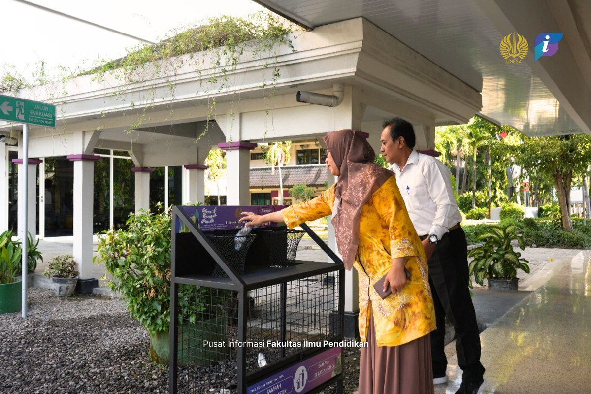
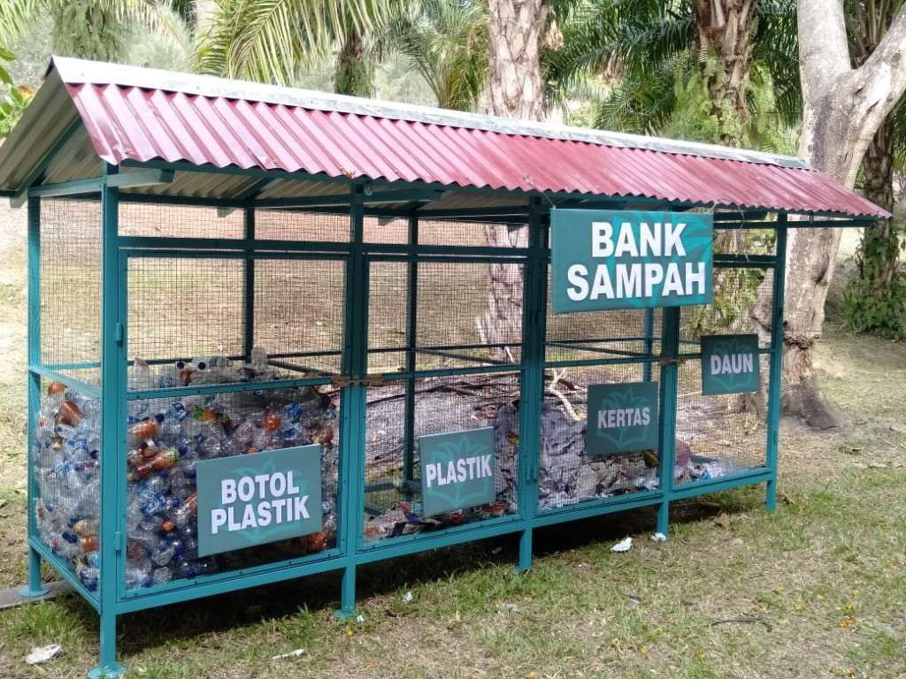
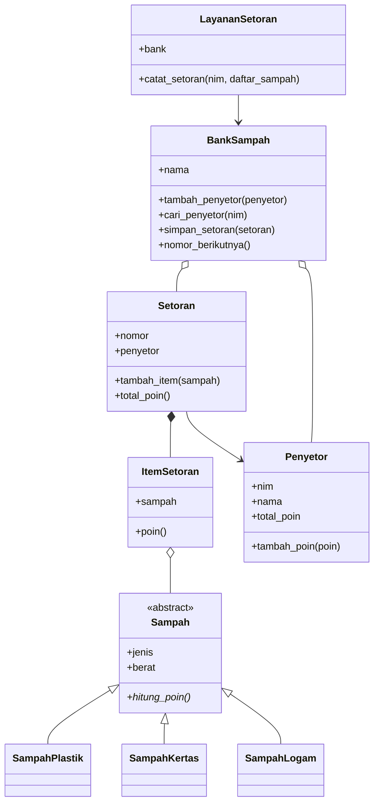

# ♻️ Bank Sampah Kampus

> Aplikasi konsol berbasis **Pemrograman Berorientasi Objek** untuk mencatat setoran sampah dan menghitung poin penyetor. Dibangun dengan Python murni dan disusun secara modular dalam *module* dan *package*.


---

## 🎓 Informasi Tugas

| | |
|---|---|
| **Mata Kuliah** | Pemrograman Berorientasi Objek |
| **Tugas** | MiniApps |
| **Capaian** | Mahasiswa mampu mengorganisasi program berorientasi objek ke dalam *module* dan *package* untuk menghasilkan struktur program yang modular dan mudah dipelihara |
| **Program Studi** | S1 Kecerdasan Artifisial |
| **Fakultas** | Matematika dan Ilmu Pengetahuan Alam |
| **Universitas** | Universitas Negeri Surabaya |
| **Tahun** | 2026 |

---

## 👥 Anggota Kelompok

| No | Nama | NIM |
|---|---|---|
| 1 | Maria Bryghita Sora Gracya | 25032014044 |
| 2 | Dimas Prabowo Adi Negoro | 25032014068 |
| 3 | Raffi Khairan Hidayat | 25032014040 |

---

## 📌 Gambaran Proyek

Bank Sampah Kampus memungkinkan mahasiswa (penyetor) menyetor sampah yang sudah dipilah. Setiap jenis sampah punya nilai poin per kilogram, dan poin dari setiap setoran otomatis ditambahkan ke total poin penyetor.

Aplikasi ini mendemonstrasikan:
- pembagian program ke dalam beberapa *package* (`models`, `services`, `utils`),
- penerapan konsep OOP pada kasus nyata,
- validasi input agar data tidak rusak,
- pengujian otomatis dengan `unittest`.

---

## 🖼️ Ilustrasi

| Pemilahan Sampah di Kampus | Contoh Bank Sampah |
|---|---|
|  |  |
| Penyetor memilah sampah plastik ke tempat sampah terpilah di lingkungan kampus. | Bank sampah dengan tempat terpisah untuk botol plastik, plastik, kertas, dan daun. |

---

## ⚡ Fitur Utama

- ➕ Mendaftarkan penyetor (NIM dan nama), NIM tidak boleh ganda
- ♻️ Tiga jenis sampah dengan nilai poin berbeda
- 🧾 Mencatat satu setoran berisi beberapa jenis sampah
- 🏆 Total poin penyetor bertambah otomatis setelah setoran dicatat
- 🔢 Nomor setoran dibuat otomatis berurutan
- 🛡️ Validasi: berat harus lebih dari nol, daftar sampah tidak boleh kosong, penyetor harus terdaftar

### Nilai Poin

| Jenis Sampah | Poin per kg |
|---|---|
| Plastik | 10 |
| Kertas | 5 |
| Logam | 20 |

Poin dihitung dari `berat × poin per kg`, hasilnya dibulatkan ke bawah menjadi bilangan bulat.

---

## 🧠 Konsep OOP yang Diterapkan

| Konsep | Penerapan |
|---|---|
| **Abstraksi** | `Sampah` adalah *abstract class* (`ABC`) dengan method abstrak `hitung_poin()` |
| **Pewarisan** | `SampahPlastik`, `SampahKertas`, dan `SampahLogam` mewarisi `Sampah` |
| **Polimorfisme** | Setiap jenis sampah meng-*override* `hitung_poin()` dengan nilai poinnya sendiri, dan dipanggil lewat satu antarmuka yang sama |
| **Enkapsulasi** | Atribut privat (`__nim`, `__total_poin`, `__items`, dll.) diakses lewat `@property` dan method |
| **Komposisi** | `Setoran` berisi `ItemSetoran`, `BankSampah` menyimpan daftar `Penyetor` dan `Setoran` |
| **Dataclass** | `ItemSetoran` memakai `@dataclass` |
| **Service layer** | `LayananSetoran` memisahkan alur pencatatan setoran dari model data |

---

## 🗂️ Struktur Proyek

```
bank_sampah/
│
├── main.py                      ← Program utama (titik masuk)
├── test_bank_sampah.py          ← Unit test
├── requirements.txt             ← Daftar dependensi (kosong, hanya pustaka standar)
├── README.md                    ← Dokumentasi (kamu di sini)
│
├── images/                      ← Gambar ilustrasi untuk README
│   ├── tempat_sampah_kampus.jpg
│   └── bank_sampah.jpg
│
├── models/                      ← Package: kelas-kelas data
│   ├── __init__.py              ← Mengekspor semua kelas lewat __all__
│   ├── sampah.py                ← Kelas abstrak Sampah
│   ├── jenis_sampah.py          ← SampahPlastik, SampahKertas, SampahLogam
│   ├── item_setoran.py          ← ItemSetoran (dataclass)
│   ├── penyetor.py              ← Penyetor (NIM, nama, total poin)
│   ├── setoran.py               ← Setoran (kumpulan item)
│   └── bank_sampah.py           ← BankSampah (penyimpanan penyetor & setoran)
│
├── services/                    ← Package: logika alur kerja
│   └── layanan_setoran.py       ← LayananSetoran.catat_setoran()
│
└── utils/                       ← Package: fungsi bantu
    └── format.py                ← format_poin()
```

### Diagram Kelas



### Alur Pencatatan Setoran

```
main.py → LayananSetoran.catat_setoran(nim, daftar_sampah)
        → validasi daftar tidak kosong
        → BankSampah.cari_penyetor(nim)
        → buat Setoran (nomor otomatis) → tambah ItemSetoran
        → BankSampah.simpan_setoran()
        → Penyetor.tambah_poin(total poin setoran)
```

---

## ⚙️ Persiapan

### 1. Pastikan Python Terpasang

```bash
python --version
```

Dibutuhkan **Python 3.8 atau lebih baru**. Di Windows, jika `python` tidak dikenali, gunakan `py`.

### 2. Siapkan Folder

Ekstrak atau salin folder proyek, lalu buka terminal **di folder paling atas** (yang berisi `main.py`).

### 3. Install Dependensi *(Opsional)*

```bash
pip install -r requirements.txt
```

Proyek ini hanya memakai pustaka standar Python (`abc`, `dataclasses`, `unittest`), jadi tidak ada paket tambahan yang perlu dipasang.

---

## 🚀 Cara Menjalankan

### Menjalankan Program

```bash
python main.py
```

Contoh keluaran:

```
Setoran ID: 1, Penyetor: Dimas, Total Poin: 55 poin
Setoran ID: 2, Penyetor: Raffi, Total Poin: 20 poin
Setoran ID: 3, Penyetor: Grace, Total Poin: 80 poin
```

Penjelasan perhitungan:

| Setoran | Isi | Perhitungan | Total |
|---|---|---|---|
| 1 (Dimas) | Plastik 2 kg, Kertas 3 kg, Logam 1 kg | 20 + 15 + 20 | 55 |
| 2 (Raffi) | Plastik 1 kg, Kertas 2 kg | 10 + 10 | 20 |
| 3 (Grace) | Logam 4 kg | 80 | 80 |

### Menjalankan Unit Test

```bash
python -m unittest -v
```

Jalankan dari folder paling atas, bukan dari dalam `models/` atau `utils/`, karena import memakai `from models...`.

---

## 💻 Contoh Penggunaan di Kode

```python
from models.bank_sampah import BankSampah
from models.jenis_sampah import SampahPlastik, SampahLogam
from models.penyetor import Penyetor
from services.layanan_setoran import LayananSetoran
from utils.format import format_poin

bank = BankSampah("Bank Sampah Kampus")
bank.tambah_penyetor(Penyetor("24001", "Dimas"))

layanan = LayananSetoran(bank)
setoran = layanan.catat_setoran("24001", [SampahPlastik(2), SampahLogam(1)])

print(format_poin(setoran.total_poin()))   # 40 poin
```

---

## 🛡️ Validasi dan Penanganan Error

| Kondisi | Hasil |
|---|---|
| Berat sampah ≤ 0 | `ValueError: Berat sampah harus lebih dari nol.` |
| Daftar sampah kosong | `ValueError: Daftar sampah tidak boleh kosong.` |
| NIM tidak terdaftar | `ValueError: Penyetor dengan nim ... tidak ditemukan.` |
| NIM didaftarkan dua kali | `ValueError: NIM sudah terdaftar.` |
| Poin negatif ditambahkan | `ValueError: Poin tidak boleh negatif.` |

---

## 🛠️ Teknologi

| Tool | Kegunaan |
|---|---|
| Python 3.8+ | Bahasa pemrograman |
| `abc` | Kelas abstrak |
| `dataclasses` | Kelas data `ItemSetoran` |
| `unittest` | Pengujian otomatis |

---

Mahasiswa **S1 Kecerdasan Artifisial**, Fakultas Matematika dan Ilmu Pengetahuan Alam, **Universitas Negeri Surabaya**, 2026.
